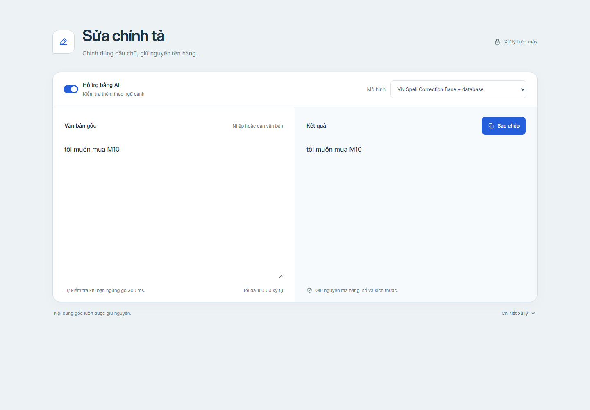
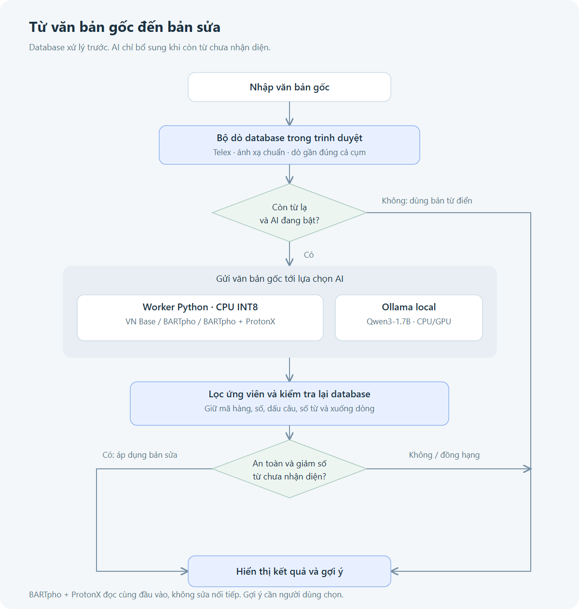
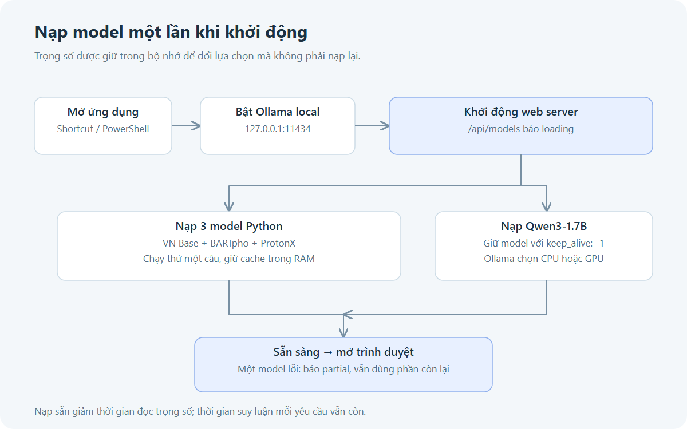

# Sửa chính tả tiếng Việt

Ứng dụng web sửa lỗi gõ, Telex và thiếu dấu cho văn bản tiếng Việt, tập trung vào tên hàng cơ khí. Database xử lý trước; model local bổ sung khi còn từ chưa nhận diện. Văn bản gốc được giữ nguyên để đối chiếu.



Ứng dụng chạy trên máy cá nhân, không cần API key. Sau khi tải thư viện và model, quá trình sửa văn bản không gọi dịch vụ AI bên ngoài.

## Nội dung

- [Cách sử dụng](#cách-sử-dụng)
- [Nguyên lý hoạt động](#nguyên-lý-hoạt-động)
- [So sánh các lựa chọn](#so-sánh-các-lựa-chọn)
- [Độ chính xác đã đo](#độ-chính-xác-đã-đo)
- [Tốc độ và nạp sẵn model](#tốc-độ-và-nạp-sẵn-model)
- [Cài đặt trên máy mới](#cài-đặt-trên-máy-mới)
- [Kiểm thử và cấu trúc dự án](#kiểm-thử-và-cấu-trúc-dự-án)

## Cách sử dụng

Trên máy đã được cấu hình, mở shortcut có sẵn trên Desktop hoặc truy cập **http://127.0.0.1:4173/** khi dịch vụ đang chạy. Bộ khởi động cũng có thể gọi bằng PowerShell trong thư mục dự án:

```powershell
powershell.exe -NoProfile -ExecutionPolicy Bypass -File scripts/start-app.ps1
```

1. Nhập hoặc dán nội dung vào **Văn bản gốc**.
2. Ngừng gõ khoảng **300 ms** để bộ dò database kiểm tra và hiện bản sửa ở **Kết quả**.
3. Bật **Hỗ trợ bằng AI** nếu cần kiểm tra thêm theo ngữ cảnh. **VN Spell Correction Base + database** là lựa chọn mặc định.
4. Chọn model khác trong danh sách **Mô hình** để đối chiếu kết quả.
5. Nếu có mục **Gợi ý**, bấm tên hàng phù hợp để áp dụng. Gợi ý không tự ghi đè nội dung nhập.
6. Bấm **Sao chép** để lấy đúng bản sửa đang hiển thị.

Mục **Chi tiết xử lý** chứa mô tả model và trạng thái nạp. Tắt AI vẫn dùng được bộ dò database và các nút gợi ý.

| Đầu vào | Hành vi đã kiểm tra |
|---|---|
| `dunhg cui rut rivet M10` | Database sửa thành `dụng cụ rút rivet M10` |
| `bulonh M8x30` | Database sửa thành `bulong M8x30` |
| `vong bii 6201-2RS` | VN Base hoặc chế độ kết hợp sửa thành `vòng bi 6201-2RS` |
| `tôi muón mua M10` | VN Base sửa thành `tôi muốn mua M10` |
| `bugf lloong M10` | Chưa tự sửa đúng; hiện gợi ý `bu lông` để người dùng chọn |
| `AirTac G1/4 SATA M10` | Giữ nguyên thương hiệu và mã kỹ thuật trong tập thử |

### Giới hạn đầu vào

| Phần xử lý | Giới hạn |
|---|---|
| Văn bản trong trình duyệt | 10.000 ký tự |
| Một yêu cầu AI | 2.000 ký tự, tối đa 12 dòng |
| VN Base / BARTpho | Tối đa 256 token mỗi dòng |
| ProtonX, kể cả chế độ kết hợp | Tối đa 160 token mỗi dòng |
| Thời gian chờ xử lý AI | 120 giây mỗi yêu cầu |

Token là đơn vị mã hóa của model, không tương đương một ký tự. Dòng vượt giới hạn token được báo lỗi thay vì cắt mất nội dung. Khi AI lỗi hoặc không có phương án phù hợp, ứng dụng giữ bản sửa từ database.

## Nguyên lý hoạt động



[Mở sơ đồ SVG để phóng to](docs/images/processing-flow.svg).

### 1. Dò database trong trình duyệt

`spellcheck.js` nạp `spelling-dictionary.json` rồi kiểm tra văn bản bằng ánh xạ sai → đúng, quy tắc Telex, cụm tên hàng và phép so khớp gần đúng có xét thừa, thiếu, thay hoặc đảo ký tự cạnh nhau. Cụm dài được xét trước từ đơn để tận dụng ngữ cảnh.

Cụm có đủ bằng chứng được sửa tự động. Cụm ngắn, nhiều lỗi hoặc còn mơ hồ được đưa vào **Gợi ý**. Các phép dò gần đúng không ghép xuyên xuống dòng, dấu câu hoặc mã kỹ thuật. Quy tắc chuẩn hóa tường minh trong database có thể đổi cách gọi, chẳng hạn `bạc đạn` → `vòng bi`.

Database hiện tại có **78.171 từ/cụm**, **442.129 ánh xạ**, **1.011 quy tắc chuẩn hóa** và **1.566 biến thể từ Telex**; file JSON khoảng **17,1 MB**. Kích thước file không phải lượng RAM sử dụng khi dựng các chỉ mục.

### 2. Gọi model khi cần

Nếu AI đang bật và còn từ chưa nhận diện, trình duyệt gửi **văn bản gốc** tới `POST /api/spelling`. VN Base, BARTpho và ProtonX chạy trong worker Python bằng CPU INT8; Qwen chạy qua Ollama trên `127.0.0.1:11434`.

Chế độ **BARTpho + ProtonX** cho hai model đọc cùng đầu vào gốc, chạy tuần tự trong một worker. Kết quả của BARTpho không được dùng làm đầu vào cho ProtonX.

### 3. Kiểm tra ứng viên trước khi áp dụng

Ứng viên phải vượt qua các kiểm tra bảo vệ mã hàng, số, thương hiệu có kiểu viết đặc biệt, dấu câu, số từ và xuống dòng. Sau đó ứng viên được dò lại bằng database. Chỉ bản sửa giảm số từ chưa nhận diện so với bản database mới được xét áp dụng.

Với nhiều ứng viên, hệ thống chọn mức giảm tốt nhất. Nếu hai phương án khác nội dung có cùng điểm tốt nhất, hệ thống giữ bản database. Nếu chỉ khác hoa/thường đầu câu, ưu tiên kiểu viết giống đầu vào. Cơ chế này giảm sửa nhầm nhưng không chứng minh rằng mọi bản sửa được chấp nhận đều đúng nghĩa.

Khi người dùng gõ tiếp hoặc chọn một gợi ý, phản hồi AI của lượt trước không được ghi đè kết quả mới. Nội dung luôn được hiển thị bằng văn bản thuần.

## So sánh các lựa chọn

| Lựa chọn trên web | Thành phần | Nơi chạy | Trọng số tải về khoảng | Vai trò |
|---|---|---|---:|---|
| Tắt **Hỗ trợ bằng AI** | Database + quy tắc + dò gần đúng | Trình duyệt | Không có trọng số AI; JSON 17,1 MB | Sửa cụm đã biết, hiện gợi ý, phản hồi nhanh |
| **VN Spell Correction Base + database** | `nrl-ai/vn-spell-correction-base` | Python, CPU INT8 | 904 MB | Mặc định; bổ sung lỗi ký tự, thiếu dấu và lỗi gõ |
| **BARTpho + database** | `bmd1905/vietnamese-correction-v2` | Python, CPU INT8 | 1,58 GB | Model sửa tiếng Việt để đối chiếu |
| **BARTpho + ProtonX + database** | BARTpho và `protonx-models/protonx-legal-tc` v1.3.1 | Python, CPU INT8 | 2,49 GB tổng cộng | So sánh hai ứng viên độc lập; dùng lại BARTpho đã tải |
| **Qwen3-1.7B · Ollama + database** | `qwen3:1.7b` | Ollama, CPU hoặc GPU | 1,36 GB | LLM local trả JSON có cấu trúc, tắt thinking |

Dung lượng trên chỉ tính trọng số, không bao gồm thư viện, cache hoặc RAM/VRAM khi chạy. Ba model Python không cần GPU; Ollama tự chọn thiết bị phù hợp. ProtonX là thành phần của lựa chọn kết hợp, chưa có lựa chọn ProtonX riêng trên web.

Các checkpoint Python được cố định trong [script tải model](scripts/setup-spelling-ai.py). Qwen được tải theo tag Ollama; nội dung tag có thể thay đổi theo thời điểm tải.

## Độ chính xác đã đo

**Đây là kết quả trên tập thử nhỏ của dự án, không phải độ chính xác chung của model.** Tập có **20 ca**, gồm **12 đầu vào có lỗi** và **8 đầu vào đúng cần giữ nguyên**. Một số ca chính là ví dụ người dùng đã đưa trong quá trình phát triển, nên tập này không độc lập với quá trình điều chỉnh hệ thống.

Một ca được tính đúng khi đầu ra khớp hoàn toàn một đáp án được chấp nhận, **có phân biệt hoa/thường, dấu câu và xuống dòng**. Các cách viết thay thế được ghi rõ trong JSON. Điểm không tính thao tác người dùng bấm chọn gợi ý.

### Kết quả của luồng dùng trên web

| Cách xử lý | Đúng / 20 ca | Tỷ lệ khớp hoàn toàn | Sửa đúng / 12 ca có lỗi | Giữ đúng / 8 ca sạch |
|---|---:|---:|---:|---:|
| Database, tắt AI | 14/20 | 70% | 6/12 | 8/8 |
| VN Base + database | 17/20 | 85% | 9/12 | 8/8 |
| BARTpho + database | 14/20 | 70% | 6/12 | 8/8 |
| BARTpho + ProtonX + database | 17/20 | 85% | 9/12 | 8/8 |
| Qwen3-1.7B + database | 15/20 | 75% | 7/12 | 8/8 |

Các hàng dùng cùng đầu vào và tiêu chí chấm. Kết quả BARTpho + database được tính lại từ ứng viên BARTpho đã lưu trong lượt thử kết hợp, qua cùng bộ lọc hiện tại. Các lượt chạy model diễn ra ở các phiên khác nhau. [Bảng tổng hợp và đầu ra từng ca](docs/benchmarks/comparison.json).

### Đầu ra từng model trước khi lọc database

| Model | Đúng hoàn toàn / 20 ca | Tỷ lệ |
|---|---:|---:|
| VN Spell Correction Base | 10/20 | 50% |
| BARTpho | 2/20 | 10% |
| ProtonX | 11/20 | 55% |
| Qwen3-1.7B | 8/20 | 40% |

Đây là đầu ra qua worker của dự án, trước bộ dò database và bộ chọn ứng viên, không phải số liệu do nhà phát hành công bố. Worker Python có xử lý khoảng trắng đầu/cuối dòng và bỏ dấu kết câu model tự thêm khi đầu vào không có. BARTpho bị trừ điểm ở cả những ca chỉ đổi hoa/thường, đồng thời vẫn có ca sửa sai tên hàng hoặc mã. Vì vậy không dùng bảng này để kết luận về chất lượng ngôn ngữ tổng quát.

Trong tập hiện tại, luồng kết hợp bảo toàn được cả 8 đầu vào sạch. VN Base và BARTpho + ProtonX vẫn chưa tự sửa đúng ba ca: `bugf lloong`, `bugf loong M10`, `toi muoomss mua dụng cu doa khoang cach`. Dòng `bugf lloong` vẫn cần người dùng chọn gợi ý `bu lông`.

Số liệu gốc được lưu cùng tài liệu để có thể kiểm tra dù thư mục `output/` chưa tồn tại:

- [VN Base](docs/benchmarks/vn-base.json) và [phân tích lượt thử](docs/vn-base-trial.md).
- [BARTpho / ProtonX](docs/benchmarks/bartpho-protonx.json) và [phân tích lượt thử kết hợp](docs/bartpho-protonx-trial.md).
- [Qwen3-1.7B](docs/benchmarks/qwen3.json).

## Tốc độ và nạp sẵn model



[Mở sơ đồ SVG để phóng to](docs/images/startup-flow.svg).

Bộ khởi động bật Ollama, bật web server, nạp thử cả ba model Python và nạp Qwen, rồi mới mở trình duyệt. Ba model Python được giữ trong cache; Qwen dùng `keep_alive: -1` để không tự nhả sau 5 phút. Lựa chọn BARTpho + ProtonX dùng lại các model đã nạp.

Trên máy thử, một lượt nạp toàn bộ mất khoảng **22,7 giây**. Đây là thời gian khởi động một lần, không phải thời gian cho mỗi lần sửa. Máy hiện tại đã có shortcut Desktop và tác vụ qua thư mục Startup khi đăng nhập Windows; bản checkout mới không tự tạo các shortcut này.

### Ví dụ thời gian sau khi đã nạp

Đo với cùng câu ngắn `tôi muón mua M10`, trên Intel Core i5-14400F, RAM 16 GB; ba model Python dùng CPU với 2 thread. Qwen trong lần đo này dùng GPU RTX 3050 6 GB.

| Lựa chọn | Thời gian xử lý model đã ghi nhận | Số lượt mẫu |
|---|---:|---:|
| VN Base | 162–279 ms | 2 |
| BARTpho | 249 ms | 1 |
| BARTpho + ProtonX | 441–450 ms | 2 |
| Qwen3-1.7B, GPU | 497 ms | 1 |

[Số liệu từng lượt](docs/benchmarks/latency-sample.json). Các số trên không bao gồm chờ ngừng gõ 300 ms, khoảng đợi gọi AI 1 giây, tải database hoặc cập nhật giao diện. **Không có cam kết mọi đầu vào chạy dưới 200 ms.** Văn bản dài, nhiều dòng, sinh nhiều token hoặc máy bận có thể mất vài giây dù model đã được nạp.

Giữ tất cả model chiếm thêm bộ nhớ. Trong một lần kiểm tra, worker Python dùng khoảng 4 GB RAM và Qwen được Ollama báo khoảng 1,7 GB trên GPU; mức dùng thực tế thay đổi theo phiên chạy.

## Cài đặt trên máy mới

Các lệnh dưới đây dành cho **Windows PowerShell**, chạy trong thư mục dự án. Cần Node.js/npm, `uv`, Python 3.13 và Ollama nếu muốn dùng đủ các lựa chọn. Phiên bản Node đã kiểm tra trên máy hiện tại: `v24.19.0`.

### 1. Cài môi trường và ba model Python

```powershell
npm ci
uv venv .venv-spelling --python 3.13
uv --system-certs pip install --python .venv-spelling/Scripts/python.exe --target .spell-runtime -r requirements-spelling.txt --index https://download.pytorch.org/whl/cpu --index-strategy unsafe-best-match
npm run setup:vn
npm run setup:bartpho-protonx
```

Lệnh cuối tải BARTpho và ProtonX. Nếu chỉ cần BARTpho, dùng `npm run setup:spelling`. Script tải file `safetensors` và tokenizer từ các commit đã cố định, không tải hay chạy mã Python từ repo model.

### 2. Cài Qwen qua Ollama

Cài [Ollama cho Windows](https://ollama.com/download/windows), mở Ollama và mở terminal mới để nhận PATH đã cập nhật, rồi chạy:

```powershell
npm run setup:qwen
```

Nếu không dùng ứng dụng Ollama ở khay hệ thống, có thể chạy `npm run start:ollama` trong một terminal riêng trước khi tải model.

### 3. Mở web và nạp sẵn

```powershell
powershell.exe -NoProfile -ExecutionPolicy Bypass -File scripts/start-app.ps1
```

Bộ khởi động mở web tại `http://127.0.0.1:4173/`. Dùng thêm `-NoBrowser` để bật dịch vụ và nạp model mà không mở cửa sổ trình duyệt.

Nếu chỉ dùng database, có thể chạy `npm start`, mở web rồi tắt **Hỗ trợ bằng AI**. Các model thiếu sẽ được ghi nhận nhưng không ngăn phục vụ trang web. Với `npm start`, có thể đặt `$env:HOST='127.0.0.1'` để chỉ nghe trên máy hiện tại; bộ khởi động đã đặt sẵn giá trị này.

### 4. Dựng lại CSS hoặc database khi cần

```powershell
npm run build:css
.venv-spelling\Scripts\python.exe scripts/build-spelling-dictionary.py
```

Chỉ dựng lại database khi có các workbook Excel gốc trong `database/`. Thư mục dữ liệu gốc không nằm trong bản checkout hiện tại; file `spelling-dictionary.json` đã tạo sẵn dùng được ngay.

## Kiểm thử và cấu trúc dự án

```powershell
npm test
.venv-spelling\Scripts\python.exe scripts/spelling-ai.test.py
```

Bộ kiểm tra bao gồm sửa chính tả, bảo vệ mã/số, từ mơ hồ, gợi ý, sao chép, hủy phản hồi cũ, API, nạp sẵn và chế độ hai model. Khi sửa UI, kiểm tra thêm trên trình duyệt ở màn hình desktop và mobile.

Để chạy lại tập 20 ca với các model đã cài:

```powershell
node scripts/benchmark-spelling.js vn-base
node scripts/benchmark-spelling.js bartpho
node scripts/benchmark-spelling.js bartpho-protonx
node scripts/benchmark-spelling.js qwen3
```

Báo cáo mới nằm trong `output/spelling/<engine>-trial.json`. Qwen yêu cầu Ollama đang chạy. Ba lệnh Python-model dùng worker riêng của script benchmark; lượt đầu có thể gồm thời gian nạp, không dùng để suy ra độ trễ khi web đã nạp sẵn. Các lệnh không tự thay bản chụp kết quả trong `docs/benchmarks/`.

| File / thư mục | Vai trò |
|---|---|
| `index.html`, `src/input.css`, `tailwind.css` | Giao diện, nguồn CSS và CSS đã build |
| `spellcheck.js` | Database, dò gần đúng, lọc ứng viên và điều khiển UI |
| `spelling-dictionary.json` | Database tĩnh đã tạo sẵn |
| `server.js` | Phục vụ tài nguyên công khai, API sửa văn bản và trạng thái model |
| `spelling-ai.js`, `scripts/spelling-ai.py` | Quản lý worker Python và suy luận local |
| `ollama-spelling.js` | Gọi Qwen local, JSON cấu trúc, giữ model trong bộ nhớ |
| `scripts/start-app.ps1` | Khởi động nền, đợi nạp model và mở web |
| `scripts/setup-spelling-ai.py` | Tải checkpoint Python đã cố định |
| `docs/images/` | Ảnh giao diện, flowchart PNG và nguồn SVG |
| `docs/benchmarks/` | Bản chụp số liệu dùng trong README |
| `.spell-models/`, `.spell-runtime/`, `.venv-spelling/` | Model và môi trường local; không đưa vào Git |
| `.cache/`, `output/` | Log, trạng thái nạp và báo cáo chạy lại |

### Trạng thái và xử lý lỗi

| Hiện tượng | Cách kiểm tra |
|---|---|
| Một model chưa sẵn sàng | Mở **Chi tiết xử lý**, xem `GET /api/models` hoặc `.cache/model-status.json` |
| Thiếu VN Base / BARTpho / ProtonX | Chạy lệnh tải tương ứng trong phần cài đặt |
| Không kết nối được Qwen | Mở Ollama, kiểm tra `ollama list` có `qwen3:1.7b` |
| Dòng quá dài cho model | Chia thành các dòng ngắn hơn, hoặc tắt AI để dùng database |
| Bản sửa không thay đổi | Model có thể chưa sửa được, hoặc ứng viên bị bộ lọc loại; xem mục **Gợi ý** |
| Đổi UI nhưng chưa thấy cập nhật | F5 hoặc Ctrl+F5 trình duyệt |
| Không khởi động được | Xem `.cache/start-error.log`, `.cache/web-error.log`, `.cache/ollama-error.log` |

`GET /api/models` trả `loading`, `ready` hoặc `partial`. Trạng thái `partial` có nghĩa một số model lỗi, các phần còn lại vẫn có thể dùng. API sửa văn bản trả 503 khi worker đang bận; UI thử lại và luôn giữ bản database trong lúc chờ.

## Nguồn model và giấy phép

- [VN Spell Correction Base](https://huggingface.co/nrl-ai/vn-spell-correction-base): Apache 2.0, theo thông tin phát hành model.
- [BARTpho sửa chính tả của bmd1905](https://github.com/bmd1905/vietnamese-correction): dùng checkpoint [vietnamese-correction-v2](https://huggingface.co/bmd1905/vietnamese-correction-v2), Apache 2.0 theo trang model.
- [ProtonX Legal Text Correction](https://huggingface.co/protonx-models/protonx-legal-tc): có [giấy phép riêng v1.3-NC](https://huggingface.co/protonx-models/protonx-legal-tc/blob/2007b3f3e577dcbebf0e5c435bfe041584920cd1/LICENSE.md), cho phép thử và dùng nội bộ; bán model hoặc cung cấp API/phần mềm trả phí có nhúng model cần giấy phép thương mại riêng. File giấy phép được giữ cùng model tải về.
- [Qwen3-1.7B trên Ollama](https://ollama.com/library/qwen3:1.7b): Apache 2.0 theo thông tin model.

Benchmark của nhà phát hành, nếu có, không được dùng thay cho kết quả 20 ca trong README này. Trước khi dùng trên danh mục hàng thực tế lớn hơn, cần bổ sung các tên hàng chưa xuất hiện trong tập phát triển và các lỗi gõ thực tế để đánh giá riêng.
