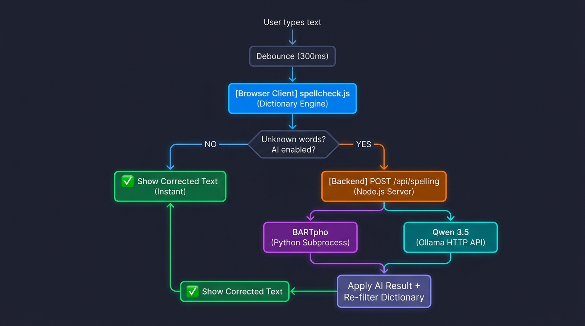
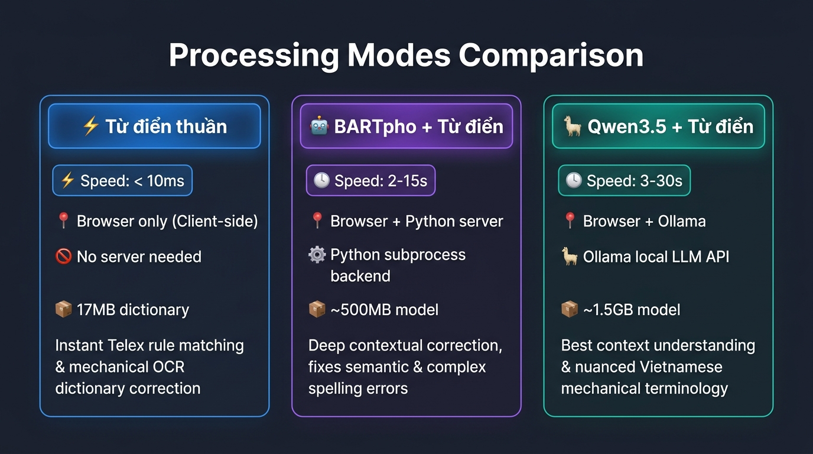
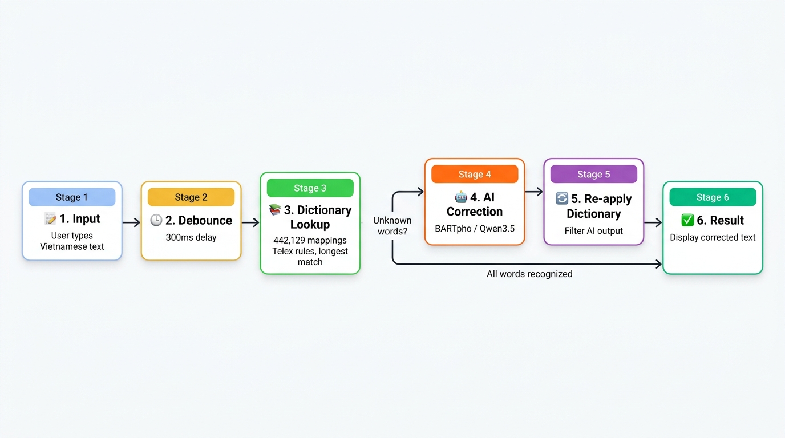

# MECSU — Sửa chính tả tiếng Việt cơ khí

Ứng dụng web sửa chính tả tiếng Việt chuyên ngành cơ khí, chạy hoàn toàn trên máy cục bộ.  
Không gửi dữ liệu ra ngoài. Hỗ trợ từ điển tĩnh tốc độ cao và hai lựa chọn AI local.

---

## Nguyên lý hoạt động



### Hai lớp xử lý

| Lớp | Nơi chạy | Tốc độ | Mô tả |
|-----|----------|--------|-------|
| **Từ điển tĩnh** | Trình duyệt | < 10 ms | Khớp cụm dài → ngắn, Telex, quy tắc chuẩn hóa |
| **AI local** | Server (CPU) | 1–30 s | BARTpho hoặc Qwen3.5 sửa từ mờ hồ |

---

## Các chế độ hoạt động

### Chế độ 1 — Từ điển thuần (mặc định khi tắt AI)

```
[Văn bản] → spellcheck.js → [Bản sửa]
```

- Nạp `spelling-dictionary.json` một lần khi mở trang (~17 MB, cache trình duyệt).
- Khớp cụm 3–8 từ trước, sau đó từng từ đơn.
- Ưu tiên cụm dài nhất duy nhất; bỏ qua từ không có đủ ngữ cảnh.
- Giữ nguyên mã, số, kích thước, dấu câu, xuống dòng.
- **Ưu điểm**: tức thì, không cần server AI.
- **Nhược điểm**: không sửa được từ viết sai hoàn toàn ngoài từ điển.

---

### Chế độ 2 — Từ điển + BARTpho (AI Python local)

```
[Văn bản]
    │
    ▼
spellcheck.js (từ điển)
    │ Còn từ chưa nhận diện?
    ├── Không → [Bản sửa từ điển]
    └── Có  →  POST /api/spelling
                    │
                    ▼
           spelling-ai.py (subprocess)
           Model: bmd1905/vietnamese-correction-v2
           (BARTpho fine-tuned, chạy CPU, INT8)
                    │
                    ▼
           Áp kết quả + lọc từ điển lần 2
                    │
                    ▼
              [Bản sửa cuối]
```

- Worker Python được spawn lần đầu khi cần, giữ trong RAM.
- Giao tiếp qua stdin/stdout JSON (mỗi dòng = 1 yêu cầu).
- Giới hạn: 2.000 ký tự, 12 dòng, timeout 120 s.
- **Ưu điểm**: sửa được lỗi ngữ nghĩa, không cần Ollama.
- **Nhược điểm**: lần đầu chậm (nạp model ~vài giây), chỉ 1 yêu cầu cùng lúc.

---

### Chế độ 3 — Từ điển + Qwen3.5 2B (Ollama local)

```
[Văn bản]
    │
    ▼
spellcheck.js (từ điển)
    │ Còn từ chưa nhận diện?
    ├── Không → [Bản sửa từ điển]
    └── Có  →  POST /api/spelling
                    │
                    ▼
           ollama-spelling.js
           fetch → http://127.0.0.1:11434/api/chat
           Model: qwen3.5:2b (think=false, temp=0)
           Định dạng JSON cấu trúc {text}
                    │
                    ▼
           Áp kết quả + lọc từ điển lần 2
                    │
                    ▼
              [Bản sửa cuối]
```

- Gọi Ollama qua HTTP REST, không spawn subprocess.
- JSON có cấu trúc → kết quả ổn định, không hallucinate.
- Giữ model trong RAM 10 phút sau mỗi lượt (`keep_alive: '10m'`).
- Giới hạn: 2.000 ký tự, 12 dòng, timeout 120 s, 1 yêu cầu/lúc.
- **Ưu điểm**: LLM mạnh hơn BARTpho, hỗ trợ ngữ cảnh dài hơn.
- **Nhược điểm**: cần cài Ollama riêng, CPU có thể mất nhiều giây.

---

## Bảng so sánh nguyên lý



| Tiêu chí | Từ điển thuần | BARTpho (Python) | Qwen3.5 (Ollama) |
|----------|:-------------:|:----------------:|:----------------:|
| Tốc độ phản hồi | < 10 ms | 2–15 s | 3–30 s |
| Chạy ở đâu | Trình duyệt | Server → Python | Server → Ollama |
| Cần server AI | ✗ | ✓ | ✓ |
| Cần Ollama | ✗ | ✗ | ✓ |
| Kích thước model | 17 MB JSON | ~500 MB | ~1.5 GB |
| Sửa lỗi Telex | ✓ | ✓ | ✓ |
| Sửa lỗi ngữ nghĩa | Giới hạn | ✓ | ✓✓ |
| Ngữ cảnh dài | ✗ | Trung bình | Tốt |
| Hoạt động offline | ✓ | ✓ | ✓ (sau pull) |
| Nhiều yêu cầu đồng thời | ✓ | ✗ (queue) | ✗ (queue) |

---

## Flowchart toàn bộ hệ thống



---

## Cài đặt & Chạy

### Chạy cơ bản (từ điển thuần)

```powershell
npm install
npm start
```

Mở `http://127.0.0.1:4173` hoặc từ mạng LAN: `http://<IP-máy>:4173`

---

### Cài BARTpho (AI Python)

Cần Node.js, `uv` và Python 3.13:

```powershell
uv venv .venv-spelling --python 3.13
uv pip install --python .venv-spelling/Scripts/python.exe --target .spell-runtime -r requirements-spelling.txt
npm run setup:spelling
```

Thư mục sau khi cài:
- `.venv-spelling/` — trình thông dịch Python
- `.spell-runtime/` — PyTorch CPU, Transformers, SentencePiece
- `.spell-models/` — trọng số BARTpho (tải theo commit cố định)

---

### Cài Qwen3.5 qua Ollama

1. Tải [Ollama cho Windows](https://ollama.com/download/windows) và cài đặt.
2. Pull model (một lần ~1.5 GB):

```powershell
ollama pull qwen3.5:2b
```

3. Khởi động server:

```powershell
npm start
```

4. Trên web: bật **Tăng cường bằng AI (local)** → chọn **Qwen3.5 2B · Ollama + database**.

---

### Rebuild từ điển (sau khi cập nhật Excel)

```powershell
npm run build:dictionary
```

---

## Kiểm tra

```powershell
npm test
```

---

## Cấu trúc từ điển

`spelling-dictionary.json` tổng hợp từ các file Excel trong `database/`:

| Nguồn | Nội dung |
|-------|----------|
| `chinhta.xlsx` | 37 nhóm, 295.070 cách viết sai → đúng |
| Database tên/đại từ | Tên hàng, nhóm hàng, tốc ký |
| Tổng cộng | 78.171 từ/cụm, 442.129 ánh xạ, 1.011 quy tắc |

- Cụm dài được ưu tiên khớp trước từ đơn.
- Ánh xạ mâu thuẫn hoặc làm thay đổi mã/số bị bỏ qua.
- Hỗ trợ gõ Telex và không dấu trong cụm đã biết.
- Mã sản phẩm, số, kích thước không dùng để sửa đoán.
